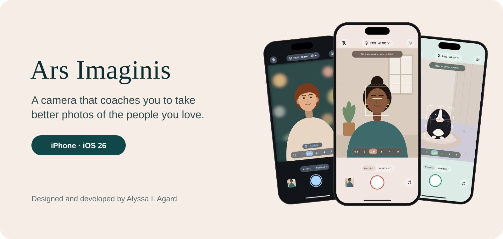

  

  <a href="https://arsimaginis.alyssaagard.dev/"><b>Explore the showcase</b></a>
  &nbsp;&middot;&nbsp;
  <a href="https://testflight.apple.com/join/1mFS1sYV"><b>Try the beta on TestFlight</b></a>

---

## What Ars Imaginis does

Ars Imaginis is an iPhone camera that coaches you while you photograph someone. It reads the scene in real time and gives one clear instruction at a time, like "tilt down," "pan left," or "move closer," then tells you when the shot looks great. Anyone can take a flattering photo of another person, whether or not they think of themselves as a photographer.

- **Live coaching.** Portrait guides find faces and bodies, mark the eye line and the upper third, notice a hand or knee cut off at the edge, flag wide-lens distortion, and read side light and backlight on the face. Optional posing tips suggest one small change at a time for one person.
- **People, animals, and still subjects.** People get the full coaching set. Animals mode keeps pets centered and fully in frame. Still Subjects turns coaching off for food, objects, and places.
- **Uncompromising quality.** Photos go through Apple's highest-quality processing and are saved exactly as the camera captured them, with the same metadata as the built-in Camera. RAW files carry a full-size preview processed by the camera, so they look finished in Photos. For fast moments, Rapid Shooting (off by default) lets the camera lighten processing on photos taken in quick succession.
- **Honest photo sizes.** RAW, HEIF, and JPEG at 12 or 48 MP, starting in HEIF at 12 MP. The pill at the top shows the real size of the next photo, and zoomed framings like 1.2, 2, and 8 are 12 MP, because the app never adds pixels the sensor did not capture.
- **Portrait and looks, always on a copy.** Portrait works at the lenses where your iPhone can measure depth without enlarging the photo (1x and 4x on iPhone 17 Pro), saving depth and a second photo with adjustable background blur. Eight color looks come with guidance for different skin undertones and light. The original is never changed.
- **Silent Live Photos.** A few seconds of motion around each HEIF or JPEG photo, recorded without sound, so the app never uses the microphone. Live Photos are off while Portrait is on, like Apple's Camera. The photo itself is still saved untouched.
- **Every lens.** Ultra wide, wide, and telephoto, opening at 24 mm (1x) by default, with optional 28 mm and 35 mm framings, a choice of default lens, and Auto Macro for close-ups. Selfies get the same coaching, zoom buttons, and an optional Mirror Front Camera setting.
- **Steady and automatic.** A dot lights up when the phone is steady enough for a sharp photo, and auto-capture can take the shot when everything is right. A courtesy flash lets the person you're photographing know the photo was taken, and Lens Smudge Alerts show a short message when the lens looks smudged.
- **Timer and Solo Mode.** A 3, 5, or 10 second timer with a large countdown, and the flash blinks on the back camera. For photos of yourself with the back camera, Solo Mode can wait until you're fully in frame, then signals with quick flashes, a chime, or both, and counts down.
- **Familiar controls.** Tap to focus and slide to adjust brightness, plus manual shutter, ISO, white balance, and focus. Icons, lens numbers, tips, and the countdown turn to stay upright when you turn the phone, unless Portrait Orientation Lock is on.
- **Yours.** Six color themes in light or dark, alternate app icons, Settings grouped by topic with each description under its option, remembered settings, a session gallery, a tour, and a full user guide.
- **Private by design.** No accounts, analytics, advertising, or network connection. Detection happens on the iPhone and is never saved.

## Why I built it

Have you ever looked forward to having your picture taken? Maybe it was a night out, a celebration, or just a day you felt great and wanted to remember it.

You hand your phone to a friend, they take the picture, and you barely recognize the person on the screen. The angle is off, the light is harsh, the lens stretches your face, and your hands are cut off at the edge. The moment you wanted to keep isn't the one you got.

It happens to almost everyone, and it isn't your friend's fault. Taking a good photo of someone is a skill, and most of us were never taught it.

That's why I built Ars Imaginis. It sits with whoever is holding the camera and does what a good photographer would: it notices what's off, says how to fix it in plain words, and lets them know when the shot is right. So the next time you feel great, your photos can show it.

The name is Latin for "the art of the image."

## At a glance

| | |
|---|---|
| **Built** | October 2026 |
| **Status** | Public beta on TestFlight |
| **Platform** | iPhone, iOS 26 or later; designed on iPhone 17 Pro |
| **Language and interface** | Swift and SwiftUI, with Liquid Glass |
| **Camera** | AVFoundation at full quality, with LiDAR and dual-camera depth for Portrait |
| **On-device intelligence** | Apple Vision for faces, bodies, and animals; Core Motion for level and steadiness |
| **Imaging** | Core Image for looks and depth blur, rendered on a separate copy |
| **Saving** | PhotoKit, with originals saved byte for byte |
| **Privacy** | Collects no data and has no network code |

## About this repository

This repository is a showcase. **The source code for Ars Imaginis is private and is not included here.**

- [`index.html`](index.html) is the showcase site, published with GitHub Pages. It includes an interactive tour of the app's screens in every theme. The phone screens are illustrations of the real layout.
- [`PRIVACY.md`](PRIVACY.md) and [`TERMS.md`](TERMS.md) are the app's Privacy Policy and Terms of Use.
- [`media/`](media) holds the app icons, the favicon, and the images used on the site.

## Rights

Copyright (c) 2026 Alyssa I. Agard. All rights reserved. Ars Imaginis is proprietary software. This repository is public for viewing only and grants no license to use, copy, or adapt Ars Imaginis or these materials. See [LICENSE](LICENSE). Licensing inquiries: appstore@alyssaagard.dev.
